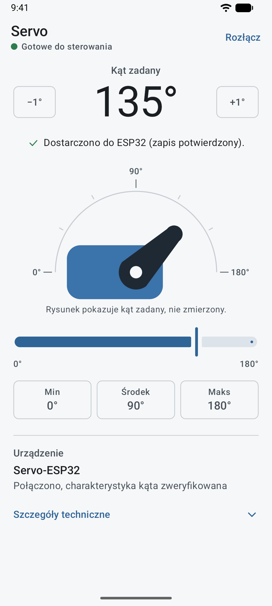
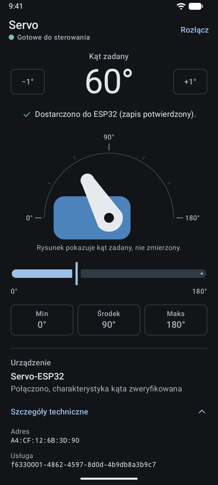
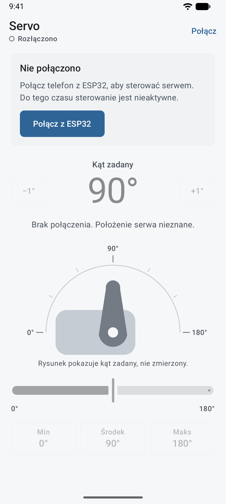
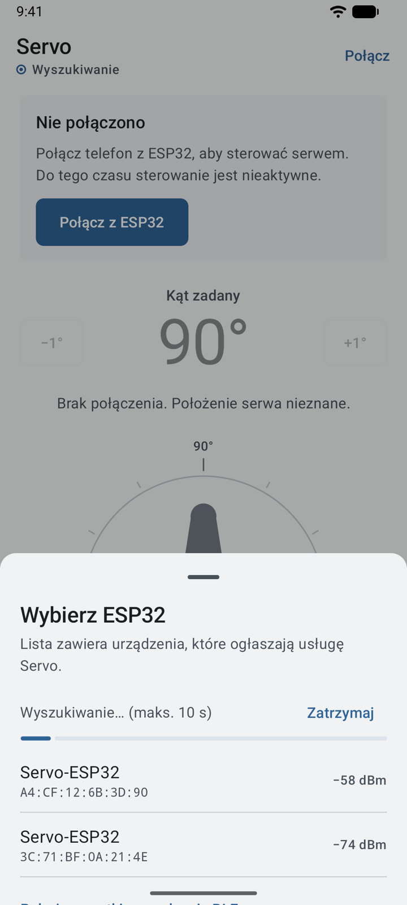
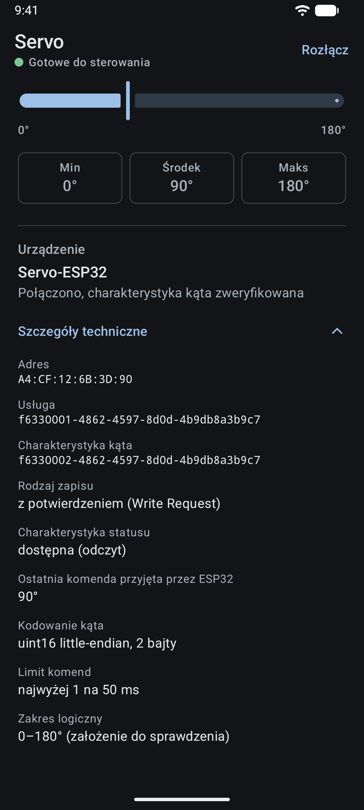
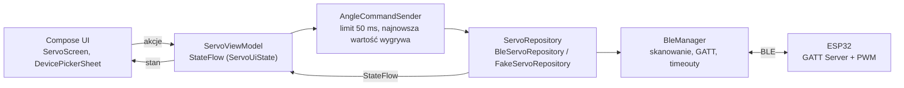

<div align="center">


# Servo

**Sterowanie serwomechanizmem z telefonu przez Bluetooth Low Energy**

Natywna aplikacja Android i firmware ESP32: od wyszukania urządzenia, przez weryfikację usługi GATT, po precyzyjne zadawanie kąta.


-34A853?logo=android&logoColor=white)


</div>

<p align="center">
  
  &nbsp;&nbsp;
  
</p>

---

## Spis treści

- [O projekcie](#o-projekcie)
- [Funkcje](#funkcje)
- [Zrzuty ekranu](#zrzuty-ekranu)
- [Architektura](#architektura)
- [Protokół BLE](#protokół-ble)
- [Uruchomienie](#uruchomienie)
- [Budowanie i testy](#budowanie-i-testy)
- [Zachowanie aplikacji](#zachowanie-aplikacji)
- [Decyzje projektowe](#decyzje-projektowe)
- [Ograniczenia](#ograniczenia)
- [Licencja](#licencja)

## O projekcie

Servo to kompletny, mały system IoT złożony z dwóch części:

| Część | Rola |
|---|---|
| **Aplikacja Android** | BLE Central / GATT Client. Wyszukuje ESP32, weryfikuje usługę i wysyła zadany kąt. |
| **Firmware ESP32** | BLE Peripheral / GATT Server. Waliduje komendę i generuje sygnał PWM dla serwa. |

Interfejs skupia się na jednym zadaniu: wygodnym ustawianiu kąta i czytelnym pokazywaniu stanu połączenia. Aplikacja konsekwentnie odróżnia **kąt zadany** od rzeczywistego położenia wału, którego nie mierzy.

> **Status:** połączenie BLE i sterowanie serwomechanizmem sprawdzono na fizycznym zestawie (telefon z Androidem, ESP32, serwo). Nie oznacza to przetestowania wszystkich scenariuszy błędów, modeli urządzeń ani wersji Androida.

## Funkcje

**Sterowanie**
- suwak z podglądem na żywo, przyciski −1° / +1° i szybkie pozycje: minimum, środek, maksimum,
- wizualizacja ramienia serwa pokazująca kąt zadany,
- ograniczanie częstotliwości komend do jednej na 50 ms, z gwarancją wysłania wartości końcowej.

**Połączenie**
- wyszukiwanie urządzeń w arkuszu wyboru z filtrem po UUID usługi,
- weryfikacja usługi i charakterystyki GATT przed odblokowaniem sterowania,
- czytelne komunikaty o błędach, timeoutach i utracie połączenia,
- odczyt ostatniego kąta przyjętego przez ESP32 po połączeniu.

**Interfejs**
- Jetpack Compose i Material 3, jasny i ciemny motyw,
- własna adaptacyjna ikona z wariantem monochromatycznym (Android 13+),
- animowany systemowy splash screen bez dodatkowej aktywności i sztucznego opóźnienia,
- stany opisane tekstem i kształtem, nie tylko kolorem, oraz etykiety dla czytników ekranu.

## Zrzuty ekranu

<table>
  <tr>
    <td align="center"></td>
    <td align="center"></td>
    <td align="center"></td>
    <td align="center"></td>
  </tr>
  <tr>
    <td align="center"><sub><b>Brak połączenia</b><br>sterowanie zablokowane</sub></td>
    <td align="center"><sub><b>Wybór urządzenia</b><br>skanowanie BLE</sub></td>
    <td align="center"><sub><b>Gotowe do sterowania</b><br>zapis potwierdzony</sub></td>
    <td align="center"><sub><b>Szczegóły techniczne</b><br>UUID, typ zapisu, limit</sub></td>
  </tr>
</table>

<sub>Zrzuty wykonano na emulatorze Androida z repozytorium testowym zamiast Bluetooth. Nazwy i adresy urządzeń są przykładowe.</sub>

## Architektura

Aplikacja korzysta z jednokierunkowego przepływu danych (UDF). Stan płynie z repozytorium przez `StateFlow` do ViewModelu i interfejsu, a akcje użytkownika wracają jako zdarzenia. Zależności są składane ręcznie w `AppContainer`, bez frameworka DI.



| Pakiet | Zawartość |
|---|---|
| `ui/` | ekran, arkusz wyboru, wizualizacja serwa, ViewModel, model stanu UI, motyw, podglądy |
| `servo/` | zakres kąta, konfiguracja, ograniczanie częstotliwości komend |
| `data/` | interfejs repozytorium, implementacja BLE, atrapa do testów i podglądów, modele |
| `ble/` | obsługa skanowania i GATT, kodowanie protokołu, uprawnienia |

Operacje GATT są wykonywane sekwencyjnie na jednym wątku logicznym, z osobnym timeoutem dla połączenia, wykrywania usług, odczytu i zapisu. Każda sesja połączenia ma własny identyfikator, więc zdarzenia z zamkniętego połączenia są ignorowane.

<details>
<summary><b>Struktura repozytorium</b></summary>

```text
.
├── app/
│   └── src/
│       ├── main/        # Kod aplikacji i zasoby (ikona, splash, motywy, teksty)
│       └── test/        # Testy jednostkowe JVM
├── docs/                # Ikona i zrzuty ekranu do README
├── firmware/
│   ├── README.md        # Konfiguracja, połączenia i wgranie firmware
│   └── esp32_servo_ble/
│       └── esp32_servo_ble.ino
├── gradle/              # Gradle Wrapper i katalog wersji
├── LICENSE
└── README.md
```

</details>

## Protokół BLE

Projekt używa własnego, demonstracyjnego protokołu GATT. Nie jest to standardowy profil BLE dla serwomechanizmów.

| Element | UUID | Dostęp |
|---|---|---|
| Usługa serwa | `f6330001-4862-4597-8d0d-4b9db8a3b9c7` | — |
| Kąt zadany | `f6330002-4862-4597-8d0d-4b9db8a3b9c7` | Write |
| Ostatni przyjęty kąt | `f6330003-4862-4597-8d0d-4b9db8a3b9c7` | Read, opcjonalna |

Kąt to dwubajtowa liczba `uint16` little-endian, w stopniach:

```text
90° → 0x005A → bajty: 5A 00
```

Wartość `FF FF` w charakterystyce statusu oznacza, że od uruchomienia ESP32 nie przyjął żadnej komendy. Firmware sprawdza długość danych i zakres kąta.

<details>
<summary><b>Co oznacza „potwierdzenie”?</b></summary>

Aplikacja rozróżnia cztery poziomy:

1. zlecenie zapisu przez telefon,
2. potwierdzenie operacji zapisu GATT,
3. ostatni kąt przyjęty przez firmware, odczytywany po połączeniu,
4. fizyczne położenie wału, które **nie jest mierzone**.

Potwierdzenie zapisu nie oznacza, że serwo osiągnęło pozycję. Charakterystyka statusu nie jest ciągłą telemetrią, a firmware nie wysyła notyfikacji BLE.

</details>

<details>
<summary><b>Zmiana protokołu lub zakresu</b></summary>

Obie części projektu muszą pozostać zgodne:

| Ustawienie | Android | Firmware |
|---|---|---|
| UUID i format danych | `ble/ServoProtocol.kt` | stałe UUID i obsługa charakterystyk |
| Zakres kąta | `servo/ServoConfig.kt` | `ANGLE_MIN`, `ANGLE_MAX` |
| Pin i parametry PWM | nie dotyczy | konfiguracja w szkicu ESP32 |

Kod Androida znajduje się w `app/src/main/java/com/example/esp32_servo/`, a firmware w `firmware/esp32_servo_ble/esp32_servo_ble.ino`.

</details>

## Uruchomienie

### Wymagany sprzęt

- telefon z Androidem 12 lub nowszym i obsługą BLE,
- płytka ESP32 z obsługą BLE (np. ESP32, ESP32-S3, ESP32-C3),
- serwomechanizm pozycyjny, np. SG90 lub MG90S,
- zasilanie dobrane do wymagań serwa i przewody połączeniowe.

> **Zakres ruchu.** Domyślny zakres logiczny to 0–180°. To zakres zadawany w protokole, a nie gwarancja zakresu mechanicznego konkretnego serwa. Zakres i parametry PWM dopasuj do swojego modelu, a pierwsze próby wykonuj bez obciążenia.

### 1. Firmware ESP32

Szczegółowa instrukcja, wybór pinu i schemat połączeń są w [dokumentacji firmware](firmware/README.md). W skrócie:

1. Ustaw `SERVO_PIN` zgodnie z połączeniami. Bez tego szkic celowo się nie skompiluje.
2. Sprawdź zakres kąta i parametry PWM.
3. Skompiluj i wgraj firmware na ESP32.

### 2. Aplikacja Android

```bash
git clone https://github.com/adrian-nafalski/esp32_servo.git
```

1. Otwórz katalog projektu w Android Studio i poczekaj na synchronizację Gradle.
2. Uruchom konfigurację `app` na fizycznym telefonie. Emulator nie obsługuje BLE.

### 3. Połączenie

1. Włącz ESP32 i w aplikacji wybierz **Połącz z ESP32**.
2. Przyznaj uprawnienie do urządzeń w pobliżu.
3. Wybierz `Servo-ESP32` i poczekaj na stan **Gotowe do sterowania**.
4. Ustaw kąt suwakiem, przyciskami lub szybkimi pozycjami.

## Budowanie i testy

```bash
./gradlew :app:assembleDebug        # budowanie aplikacji
./gradlew :app:testDebugUnitTest    # testy jednostkowe
./gradlew :app:lintDebug            # analiza lint
```

Na Windowsie użyj `gradlew.bat`.

Testy jednostkowe działają na wirtualnym czasie (`kotlinx-coroutines-test`) i obejmują m.in.:

- kodowanie i dekodowanie danych protokołu,
- walidację zakresu kąta,
- ograniczanie częstotliwości komend i wysyłanie wartości końcowej gestu,
- przejścia stanów ViewModelu,
- usuwanie oczekujących komend po rozłączeniu,
- brak automatycznego wysyłania kąta po połączeniu.

Testy JVM nie zastępują sprawdzenia komunikacji BLE i zachowania serwa na sprzęcie.

## Zachowanie aplikacji

<details>
<summary><b>Wysyłanie komend</b></summary>

Podgląd kąta aktualizuje się w trakcie przesuwania suwaka, a wysyłanie BLE jest od niego oddzielone.

- Komendy są ograniczane czasowo, domyślnie do jednej na 50 ms.
- Oczekująca wartość jest zastępowana nowszą, więc nie powstaje kolejka nieaktualnych kątów.
- Zapisy są wykonywane sekwencyjnie.
- Po zakończeniu gestu aplikacja wysyła wartość końcową, jeśli połączenie nadal jest gotowe.
- Błędy i timeouty są widoczne w interfejsie, a nieudaną komendę można ponowić.

</details>

<details>
<summary><b>Połączenie i rozłączenie</b></summary>

- Samo połączenie GATT nie odblokowuje sterowania. Najpierw aplikacja sprawdza usługę i charakterystykę.
- Po rozłączeniu sterowanie jest blokowane, a oczekujące komendy usuwane.
- Po ponownym połączeniu poprzednie komendy nie są odtwarzane.
- Aplikacja nie wysyła pozycji początkowej tylko z powodu uruchomienia lub połączenia.

Zachowanie serwa po restarcie lub rozłączeniu ESP32 zależy też od firmware i konfiguracji PWM.

</details>

<details>
<summary><b>Praca w tle</b></summary>

Aplikacja nie używa usługi pierwszoplanowej. Po przejściu do tła:

- skanowanie zatrzymuje się od razu,
- połączenie jest zamykane po 10 sekundach,
- powrót do aplikacji nie łączy się automatycznie i nie wysyła kąta.

Obrót ekranu ani zmiana motywu nie są traktowane jako żądanie rozłączenia.

</details>

<details>
<summary><b>Uprawnienia</b></summary>

| Uprawnienie | Cel |
|---|---|
| `BLUETOOTH_SCAN` | wyszukiwanie urządzeń, z flagą `neverForLocation` |
| `BLUETOOTH_CONNECT` | połączenie i komunikacja |

Aplikacja nie prosi o lokalizację i nie korzysta z internetu. Prośba o uprawnienia pojawia się dopiero przy wyborze urządzenia, nie przy starcie.

</details>

## Decyzje projektowe

- **Kąt zadany, nie zmierzony.** Serwo hobbystyczne nie zwraca położenia, więc interfejs nigdzie nie sugeruje, że je zna.
- **Brak ruchu bez decyzji użytkownika.** Uruchomienie, połączenie ani powrót z tła nie wysyłają żadnej komendy. Po połączeniu suwak przejmuje ostatni kąt przyjęty przez ESP32, więc pierwsze dotknięcie nie szarpie serwem.
- **Najnowsza wartość wygrywa.** Szybki ruch suwaka nie tworzy kolejki zaległych komend, a wartość końcowa zawsze zostaje wysłana.
- **Testowalność.** Logika protokołu, limitu komend i stanu jest oddzielona od Androida i testowana na JVM. Ta sama atrapa repozytorium zasila testy i podglądy Compose.
- **Minimum uprawnień i zależności.** Tylko dwa uprawnienia Bluetooth, systemowe API splash screena i ręczne wstrzykiwanie zależności zamiast frameworka.

## Ograniczenia

- Aplikacja pokazuje kąt zadany, nie zmierzone położenie wału.
- Brak informacji, czy serwo osiągnęło pozycję, zostało zablokowane lub przestawione ręcznie.
- Zakres logiczny i parametry PWM trzeba dopasować do konkretnego egzemplarza serwa.
- Kierunek ruchu na rysunku nie musi odpowiadać kierunkowi fizycznego wału.
- Podstawowe działanie potwierdzono na fizycznym zestawie, ale nie na wszystkich modelach telefonów, ESP32 i wersjach Androida.
- Firmware nie uwierzytelnia klienta. Nazwa urządzenia i UUID nie są zabezpieczeniem.
- To projekt edukacyjny i demonstrator sterowania, nie system do zastosowań wymagających gwarantowanego bezpieczeństwa ruchu.

## Licencja

Projekt jest udostępniony na licencji [MIT](LICENSE).
